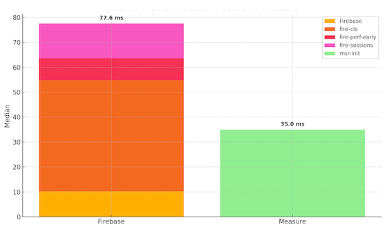
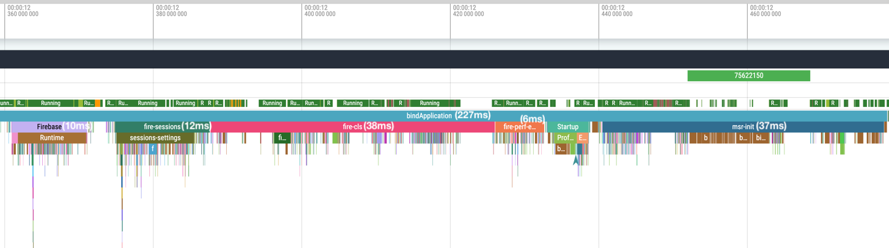

See the platform-specific sections below for details on the performance impact of the Measure SDK on your app.

## Android

### Benchmarks

We benchmark the SDK's performance impact using a Pixel 4a running Android 13 (API 33). Each test runs 35 times using
macro-benchmark. For detailed methodology, see [android/measure-android/benchmarks](https://github.com/measure-sh/measure/blob/main/android/measure-android/benchmarks/README.md).

<Callout type="warn">

Benchmark results are specific to the device and the app. It is recommended to run the benchmarks
for your app to get results specific to your app. These numbers are published to provide
a reference point and are used internally to detect any performance regressions.

</Callout>

Benchmarks results for v0.16.0:

* Adds 17.5ms-31.3ms (24.3ms median) to the app startup time (Time to Initial Display) for a simple app.
* Adds 0.6-1ms to detect and create a layout snapshot for click gestures.

### Profiling

To measure the SDK's impact on your app, we've added traces to key areas of the code. These traces help you track
performance
using [Macro Benchmark](https://developer.android.com/topic/performance/benchmarking/macrobenchmark-overview)
or by using [Perfetto](https://perfetto.dev/docs/quickstart/android-tracing) directly.

Here's the table:

| Metric                      | Description                                                                                             |
|-----------------------------|---------------------------------------------------------------------------------------------------------|
| `msr-init`                  | Time spent on the **main** thread while initializing                                                    |
| `msr-start`                 | Time spent on the **main** thread when `Measure.start` is called                                        |
| `msr-stop`                  | Time spent on the **main** thread when `Measure.stop` is called                                         |
| `msr-trackEvent`            | Time spent in storing an event to local storage. Almost all of this time is spent _off_ the main thread |
| `msr-trackGesture`          | Time spent on the **main** thread to track a gesture                                                    |
| `msr-generateSvgAttachment` | Time spent on **background** thread to generate an SVG layout                                           |
| `msr-captureScreenshot`     | Time spent on **main** thread to capture and compress a screenshot                                      |
| `msr-loadImageFromFile`     | Time spent on **main** thread to load an image from a file                                              |
| `msr-loadImageFromUri`      | Time spent on **main** thread to load an image from a Uri                                               |

### Comparison to Firebase initialization

The following are the results from running a macro-benchmark test to compare initialization
time of Measure SDK vs Firebase. Tested with firebase BOM version `33.7.0` and
Measure Android SDK version `0.10.0` running on a Pixel 4a.

Firebase initializes in multiple phases. The total median time to initialize when running the
benchmark for an app with Firebase crashlytics, performance and analytics SDK
was observed as `77.6ms`. While Measure took `35.0ms` in the same macro-benchmark test.

Perfetto screenshot from one of the runs:

## iOS

## Benchmarks

We benchmarked the iOS SDK's performance impact using a baseline app on an iPhone 17
running iOS 26.6. Each scenario was executed _10 times_ and instrumented with `os_signpost` for
precise time tracking. Metrics were collected via Instruments (Time Profiler with the os_signpost
instrument).

<Callout type="warn">

Performance impact varies based on device and application complexity.
We recommend measuring impact in your specific app.
The following numbers serve as a reference baseline and are used internally to monitor regressions.

</Callout>

### Benchmark Results (v0.15.0)

Measure adds **31.3–49.1 ms (median 35.4 ms)** to app startup time (Time to Initial Display). Other
key operations performed by the SDK can be found below:

| Operation                    | p95     | Description                                                    |
|------------------------------|---------|----------------------------------------------------------------|
| `trackEvent`                 | 32 µs   | Includes event collection, attribute enrichment and queueing   |
| `appendAttributes`           | 56 µs   | Dynamic attribute gathering (e.g., network, device state)      |
| `trackBugReport`             | 10.5 ms | Bug report processing and storage, including its attachments   |
| `trackEventUserTriggered`    | 28 µs   | User-triggered event tracking                                  |
| `trackSpanTriggered`         | 6 µs    | When a trace event is emitted                                  |
| `spanProcessorOnStart`       | 84 µs   | Span construction                                              |
| `spanProcessorOnEnded`       | 45 µs   | Span serialization and buffering                               |
| `generateScreenshot`         | 59 ms   | Capturing the UI, masking and compression                 |
| `generateLayoutSnapshotJson` | 2.8 ms  | Layout hierarchy capture                                       |
| `trackAppHang`               | 1.8 ms  | Storing the app hang event once a hang is detected             |
| `appHangPing`                | 11 µs   | App hang detection check, which runs about 20 times per second |
